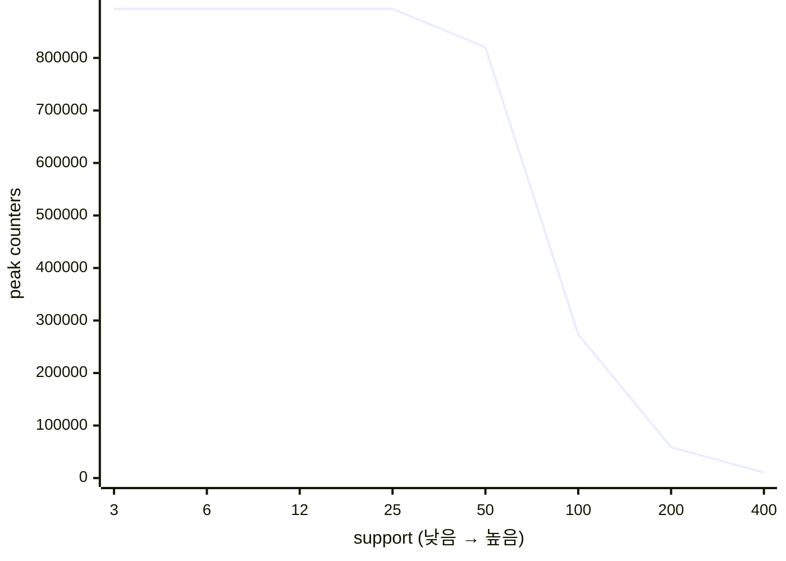
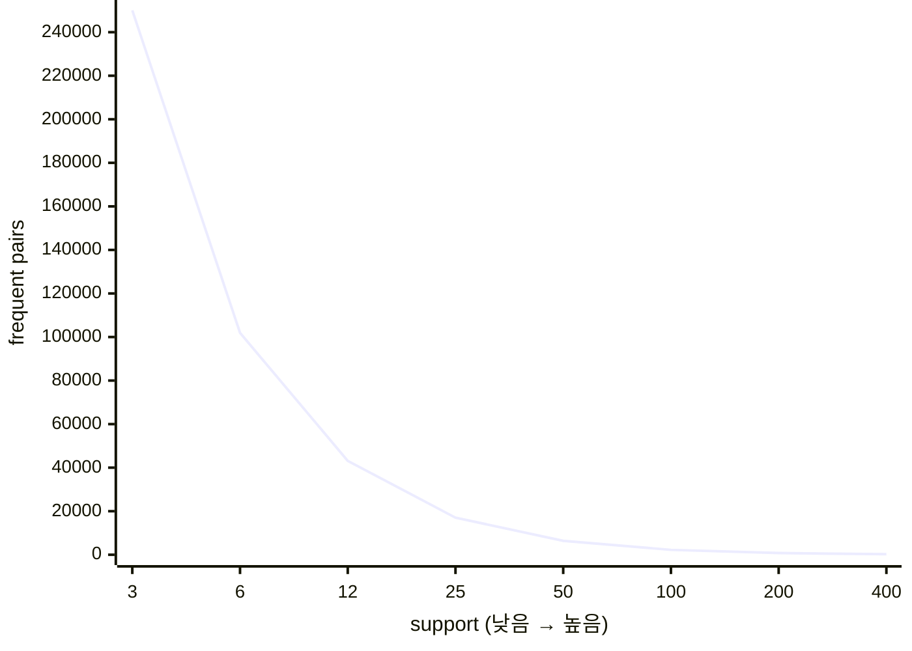

# Task 2 · Support threshold explosion

## 측정 환경

- CPU: Intel(R) Core(TM) i9-14900HX (32 logical CPUs)
- RAM: 15.4 GiB
- OS: Linux-6.6.87.2-microsoft-standard-WSL2-x86_64-with-glibc2.39
- Python: 3.12.3
- 측정 시작 시 시스템 부하(1/5/15분): 0.31, 0.15, 0.10
- 함께 실행 중이던 프로세스(측정 Python 제외): 1개 (codex)

## 측정 결과

| support | frequent pairs | peak counters | time (s) | peak memory (MiB) |
|---:|---:|---:|---:|---:|
| 400 | 249 | 10,585 | 0.52 | 1.0 |
| 200 | 776 | 58,626 | 0.91 | 6.1 |
| 100 | 2,244 | 273,701 | 1.48 | 25.3 |
| 50 | 6,397 | 820,259 | 2.62 | 97.7 |
| 25 | 17,045 | 893,456 | 3.10 | 97.7 |
| 12 | 43,116 | 893,456 | 3.12 | 98.0 |
| 6 | 101,938 | 893,456 | 3.14 | 113.8 |
| 3 | 250,054 | 893,456 | 3.53 | 149.3 |

## 증가 곡선

두 값의 크기 차이가 커서 각각의 축으로 표시했다.

## 관찰

- support 400→50에서 카운터는 77.5배, 정답 쌍은 25.7배 증가했다. 지원도를 절반씩 낮출 때로 환산하면 각각 약 4.26배와 2.95배다.
- support 50→3에서는 관측 가능한 후보 공간이 거의 포화되어 카운터는 1.09배에 그쳤지만 정답은 39.1배 늘었다.
- support 50에서 정답 6,397개를 찾는 데 후보 820,259개, 즉 약 128배의 카운터가 필요했다. 정답보다 훨씬 큰 후보 공간을 유지해야 하는 이 간극 때문에 임계값을 조금 낮추는 것도 비싸다.
- 가장 부담스러웠던 측정은 support 3였고, 중단/종료 판단 근거는 `support 3에서 후보 카운터와 메모리 사용량이 충분히 커져 더 낮추면 시스템 응답성이 나빠질 위험이 있어 중단`이다.
